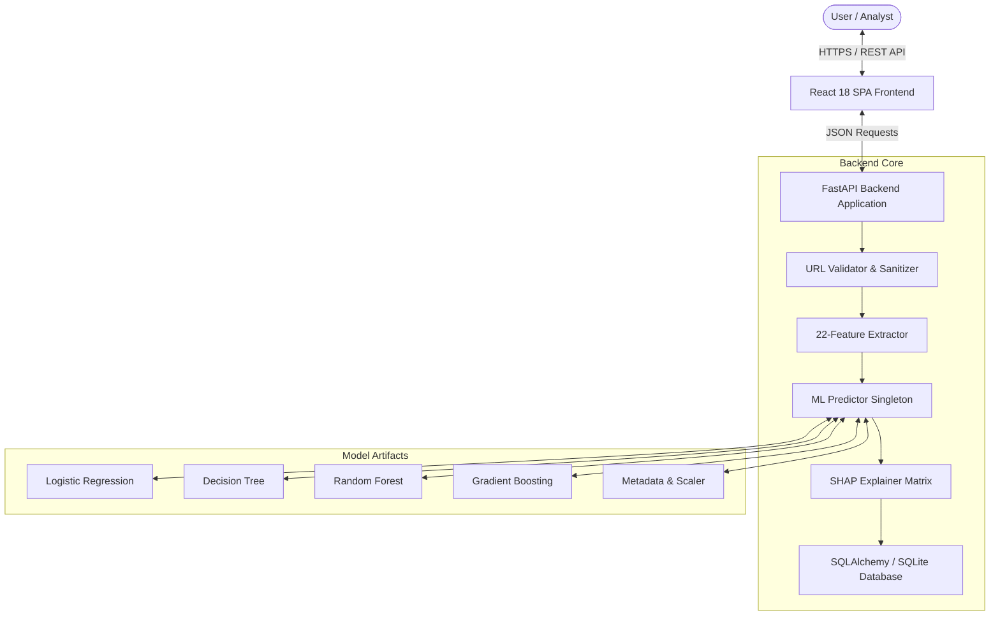
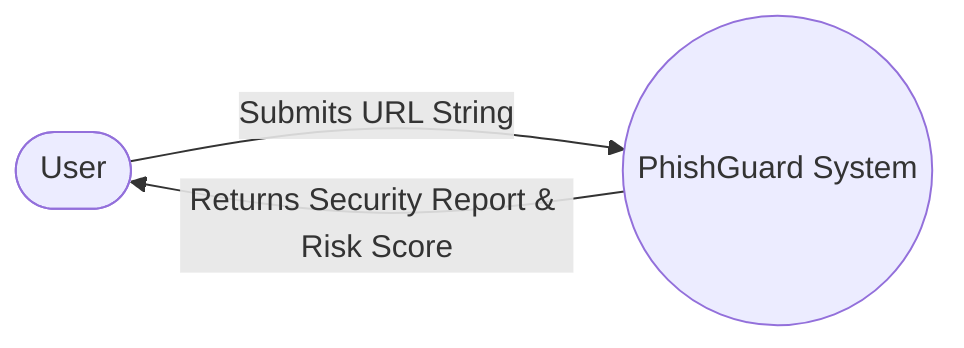
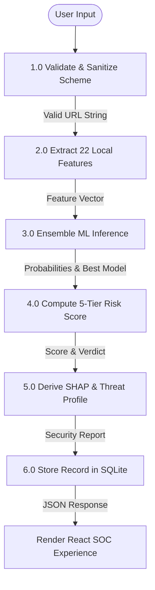
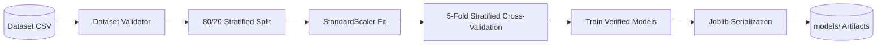
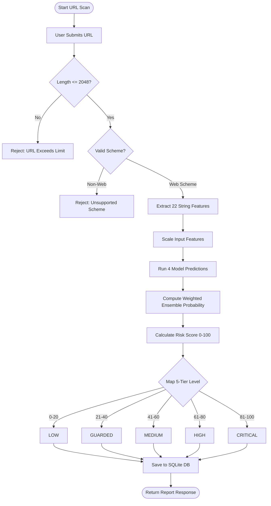
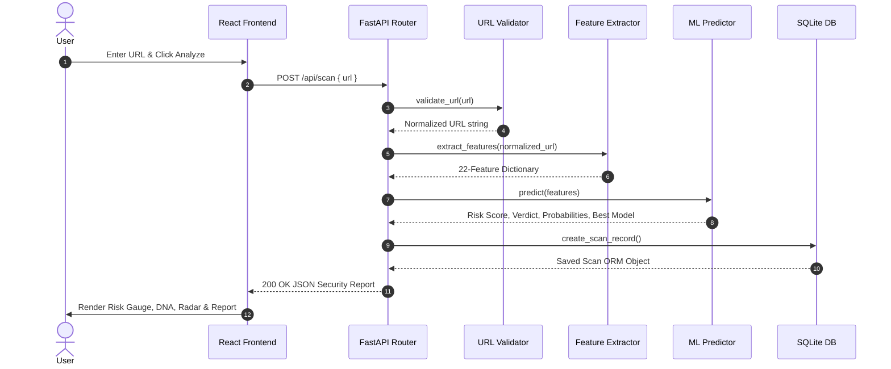
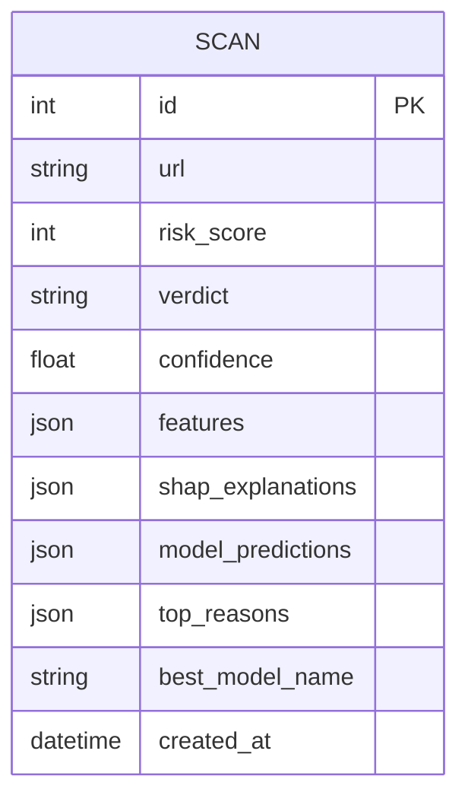

# PhishGuard — System Architecture & Diagrams

## 1. High-Level Architecture Overview

PhishGuard follows a decoupled, three-tier architecture comprising a React Single Page Application (SPA), a FastAPI RESTful Web Server, and an embedded Machine Learning Inference Core backed by SQLite storage.

---

## 2. Data Flow Diagram (DFD)

### DFD Level 0 (Context Diagram)

### DFD Level 1 (Process Breakdown)

---

## 3. Machine Learning Pipeline Diagram

---

## 4. Phishing URL Detection Flowchart

---

## 5. Scan Processing Sequence Diagram

---

## 6. Entity Relationship (ER) Diagram

